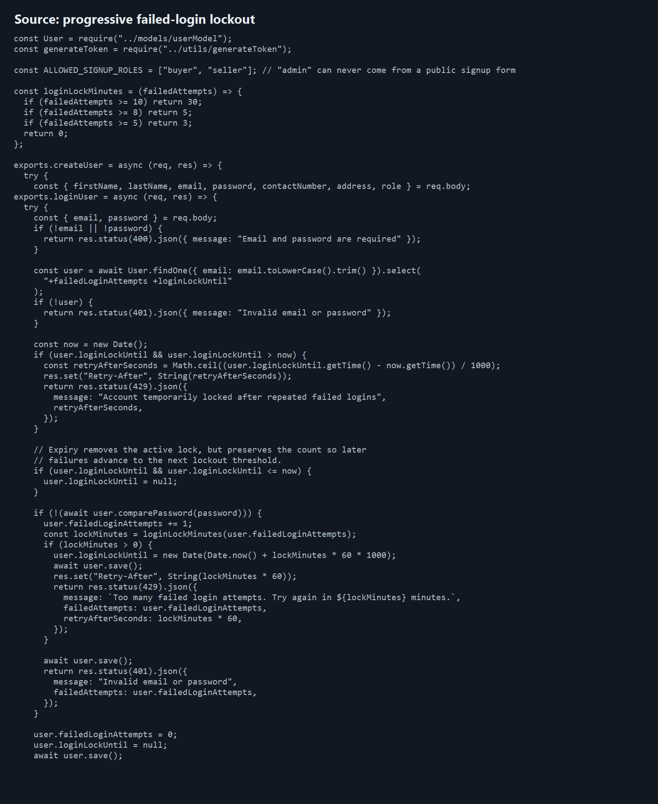
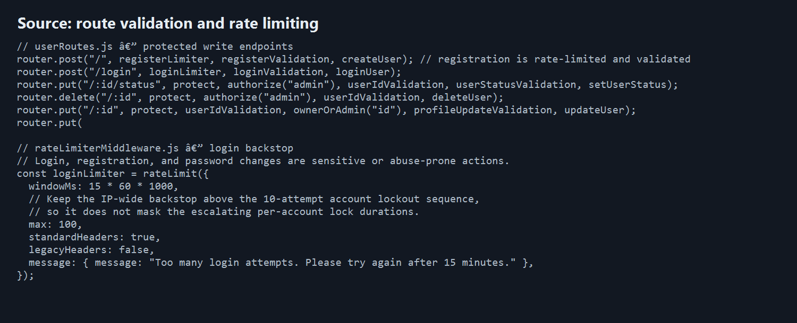
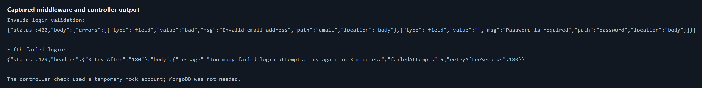

# Rate limiting and input validation evidence

## Route review

| Route group | Endpoints covered | Validation | Rate limit |
| --- | --- | --- | --- |
| Users and demo users | Register, login, profile/password changes, IDs, status | Registration/login fields, profile/password fields, status, MongoDB IDs | Login, registration, password changes |
| Categories | Public category ID lookup; admin create/update/delete | MongoDB IDs and category fields | Catalog writes |
| Products (both route versions) | Product query, ID lookup, create/update/delete | Query filters, MongoDB IDs, product fields | Catalog writes |
| Cart | Get, add item, remove item, clear | User/product IDs, product ID, quantity, price | Cart writes |
| Orders | Create, read by ID/user, status update, delete | Order fields/items/status and MongoDB IDs | Order writes |
| Reviews | Create, read by product/user, update, delete | Review fields and MongoDB IDs | Review writes |

## Progressive login delay

Failed-login counts are stored on the user record. At 5 failures the lock is 3 minutes; at 8 it is 5 minutes; at 10 it is 30 minutes. Further failures during each tier renew that tier's delay. The lock response includes HTTP 429, `Retry-After`, `failedAttempts`, and `retryAfterSeconds`. A successful login resets the counter.

## Captured output

Invalid email/password input returned HTTP 400 with field errors. The simulated fifth failed login returned HTTP 429 with `Retry-After: 180` and a 180-second retry interval. The login output was produced by invoking the controller with an in-memory mock user; it did not require a database connection.

## Screenshots

